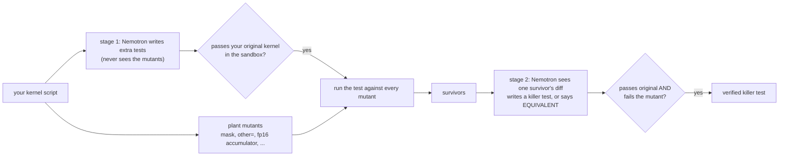

# triton-mutant-gate (Mutant Replay)

**Does your test suite really protect your Triton kernel?** This tool plants small bugs ("mutants") in a kernel, runs
the tests against every one of them in a Nebius sandbox, and asks Nemotron to write tests for the bugs that slipped
through. A test is accepted only if it **passes your original kernel and fails the buggy copy**. Nothing a model says
is trusted without running the code.

Built for the Nebius x NVIDIA Global AI Hackathon, track *Coding and Agentic Engineering*.

- **Replay demo:** https://alexxony.github.io/triton-mutant-gate/ (static page of recorded runs, source `demo/index.html`; nothing runs in the browser)
- **Recorded results and limits:** [docs/RESULTS.md](docs/RESULTS.md) · **Prior art:** [docs/PRIOR_ART.md](docs/PRIOR_ART.md)

## How it works



## Where Nemotron, Token Factory and Nebius tools are used

- **Nemotron on Token Factory** (`https://api.tokenfactory.nebius.com/v1`): writes the extra tests (stage 1) and, for each
  surviving mutant, either a killer test or an `EQUIVALENT` verdict (stage 2). Default model
  `nvidia/nemotron-3-super-120b-a12b`; `Nano-30B-A3B` and `Ultra-550b-a55b` were also run (see docs/RESULTS.md). Every call
  checks that the response names the requested model.
- **Nebius Sandboxes** (through the `contree-sdk`): every test execution (original and each mutant) runs in a disposable
  sandbox with the Triton CPU interpreter (`TRITON_INTERPRET=1`) plus out-of-bounds checks, so no generated code runs on
  your machine.
- Why Token Factory helps: the whole study (every model, five repeats each) used about 1.5M tokens. The Super-only part
  (343,276 tokens) cost about $0.17 at list price, which is what makes repeating each experiment five times practical.

## Quick start

Requires Python 3.12+, [uv](https://docs.astral.sh/uv/), a Nebius Token Factory API key and Nebius Sandboxes access.

```bash
git clone <this repo> && cd triton-mutant-gate
uv sync
export NEBIUS_API_KEY=...            # Token Factory key (never commit it)

uv run mutant-gate mutants examples/kernels/layernorm.py --diff   # offline: list the planted bugs
uv run mutant-gate setup-image                                    # once, ~1 min: Python + Triton + CPU torch in a sandbox image
uv run mutant-gate run examples/kernels/layernorm.py              # the full gate (about 30k tokens for layernorm)
```

Output goes to `mutant-gate-out/<kernel>/`: `report.md` (summary table), `report.json`, `generated_test.py` and `raw/`
(every model reply). Options: `--model`, `--tries`, `--no-close` (skip stage 2), `--compile-check`, `--image`, `--out`.
`--compile-check` compiles every launch of each survivor for CUDA (sm_75, no GPU needed, inside the same sandbox) and sets
aside survivors that are not valid GPU programs, so Nemotron is not asked to write tests for them.
Tests (offline): `uv run pytest`.

Example output for `examples/kernels/layernorm.py` (one real run): 18 bugs planted, 13 caught by the generated test,
5 survived; stage 2 produced one verified killer test (`drop_eps`), called three survivors equivalent and found no
accepted test for one. Results vary between runs (temperature 0.2).

## Your own kernel: script format

Any ordinary Triton file works, for example `examples/plain/leaky_relu.py`:

- every top-level `@triton.jit` function is mutated (with several kernels, sites read `kernel_name:load#0`);
- imports, defs and classes form the program the tests build on; whatever runs after them (the body of
  `if __name__ == "__main__":`, or the top-level statements after the last def) is your existing sanity check and is run
  unconditionally. A file with only definitions is fine, it just has no existing check;
- `"cuda"` device strings and `.cuda()` calls are pointed at the CPU inside the sandbox (the log says how many);
- before anything else the unmodified file must run in the sandbox (CPU, Triton interpreter, bounds checks on); if it does
  not, `run` stops with the last stderr line. Code that needs a real GPU feature, a package missing from the image, or
  command-line arguments will stop there. `@triton.autotune` stacks are kept but not tuned.

The older layout of `examples/kernels/*.py` (a `tier = sys.argv[1]` line between the helpers and the check) is still read as
before. Generic mutants (dropping `mask`/`other`, `<` to `<=`, fp32 to fp16 accumulators) apply to any kernel; softmax,
layernorm and matmul specific ones fire only when the matching code pattern is present.

## Limits (read before trusting a verdict)

- The Triton **CPU interpreter is not a compiler**. In a pre-registered check on a Colab T4 (Triton 3.6.0), the three fp16
  accumulator survivors turned out not to compile ("loop-carried variable ... re-assigned to fp32"), so the interpreter let
  invalid mutants through; in the other direction, a compiled run missed most dropped-mask bugs that the interpreter's bounds
  checks catch. `mutant-gate run --compile-check` now catches the first kind (compile errors) on CPU; it cannot tell whether a
  compiled run would pass or fail the test, and what compiles depends on the Triton version in the sandbox image (3.8.0)
  ([details](docs/RESULTS.md#compiled-gpu-run-colab-t4)).
- Mutants come from a fixed set of rewrite rules, not real bug reports. "Equivalent" is the model's opinion plus sampled
  inputs, not a proof.
- Four tutorial-style kernels only. The data does not support ranking the three Nemotron models.
- A model that only *reads* the test and the diff (no execution) predicted catch/survive correctly 86.9% of the time
  versus a 79.4% always-"caught" baseline, so execution is not shown to be strictly necessary; it matters most for numeric
  behaviour. Details in docs/RESULTS.md.
- Every part of the idea (LLM test generation against mutants, GPU-kernel mutation analysis, equivalent-mutant
  detection) exists in earlier work; this repository is a combination, not a new method.

## Repository layout

| path | contents |
|---|---|
| `src/mutant_gate/` | CLI, mutation operators, prompts, sandbox runner, the two-stage pipeline |
| `examples/kernels/` | the four kernels used in the study |
| `demo/` | replay page (`index.html`), its data and the builder (`uv run python demo/build_demo_data.py`) |
| `recorded/` | raw results of the study (JSON, model replies, prior-art survey outputs) |
| `tests/` | offline unit tests |

## License

MIT, see [LICENSE](LICENSE). The example kernels adapt the Triton tutorials (MIT, OpenAI and the Triton contributors);
see [THIRD_PARTY.md](THIRD_PARTY.md).
